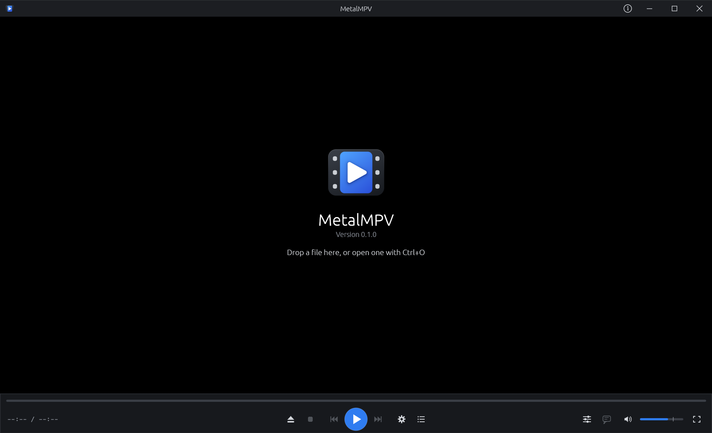
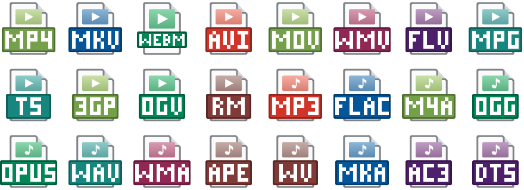

<p align="center">
  
</p>

<h1 align="center">MetalMPV</h1>

<p align="center">A fast video player for Windows built on libmpv</p>

<p align="center">
  <a href="https://github.com/Fan4Metal/metalmpv/releases/latest"></a>
  
  
  <a href="LICENSE"></a>
</p>

<p align="center"><b>English</b> | <a href="README.ru.md">Русский</a></p>

MetalMPV is a video player for Windows with a classic layout: the picture fills the window, the seek bar and the buttons sit under it with Play in the middle, and the playlist opens on the right. Playback is done by [libmpv](https://mpv.io), the library of the mpv player, so practically every video and audio format plays, with hardware decoding where the graphics card supports it. The program is built for opening files quickly and for instant seeking on keyframes.



*Screenshot of version 0.1.0.*

## Features

- **Fast start**: the playback engine starts while the window is being created; on a warm start the first frame of a 1080p file appears about 0.4 s after the program is launched.
- **Instant seeking on keyframes** with the arrow keys, exact seeking and frame stepping on other keys (see [Keyboard shortcuts](#keyboard-shortcuts)); every seek is reported on the screen.
- **Every common format**: MP4, MKV, AVI, MOV, WebM, TS, WMV and more, audio files included; subtitles next to the video are loaded automatically.
- **Audio tracks and subtitles** in one window by the volume (`T`), both lists side by side; subtitles from a file of their own by **Load from a file…** or by dropping the file onto the playing video (see [Audio and subtitles](#audio-and-subtitles)).
- **File information** (`I`): the cover, the tags, the size, the container and the details of every track in a window that stays over the player while it plays; the cover of an audio file fills the picture (see [File information](#file-information)).
- **Chapters**: marks on the seek bar, which can be turned off, and a list under the playlist to go to a chapter (see [Chapters](#chapters)).
- **Hardware decoding** (NVDEC, D3D11VA and others, chosen by libmpv), which can be turned off in the settings.
- **Playlist**: files opened together, dropped onto the window or added with the **+** button of the playlist; optionally the other media files of the folder of an opened file.
- **One window**: a file opened from Explorer while the player runs is played in the window already open.
- **File types**: the player can be registered with Windows for its video and audio formats, each with an icon of its own, and chosen as the default player (see [File types](#file-types)).
- **English or Russian interface**: it follows the language of Windows and can be changed in the settings (`F5`).
- **Portable**: the [portable archive](#installation) keeps its settings next to the program.
- **Privacy**: no network access beyond the optional update check (see [Update check and privacy](#update-check-and-privacy)).

## Installation

The installer and the portable archive are on the [Releases](https://github.com/Fan4Metal/metalmpv/releases) page.

The installer, `MetalMPV_<version>_Setup.exe`, needs no administrator rights: the program is placed in `%LOCALAPPDATA%\Programs\MetalMPV`. The installed program keeps its settings in `%APPDATA%\MetalMPV`. Its **File types** task, on by default, registers the player for its formats (see [File types](#file-types)); on the last page it offers to open Windows Settings to choose the player as the default. Uninstalling removes the registration.

The portable archive, `MetalMPV_<version>_portable.zip`, holds the program in a `MetalMPV` folder and runs without installation. It also holds an empty `metalmpv.ron`. While that file is next to `metalmpv.exe` and the folder is writable, the settings are kept in it, so the program can be carried on a removable drive. Without the file, the program keeps them in `%APPDATA%\MetalMPV`, as the installed program does. The About window shows where the settings are kept.

Both contain `libmpv-2.dll` (about 115 MB unpacked), the playback engine, which must stay next to `metalmpv.exe`.

The executables are not code-signed, so Windows SmartScreen may warn about an unknown publisher on first launch.

## Usage

A file is opened with the **Open** button (the eject symbol, `Ctrl+O`), by dropping it onto the window, from Explorer (**Open with**), or from the command line: `metalmpv.exe file.mkv [more files]`. Several files make a playlist; at the end of a file the next one starts.

The window has its own title row: it is moved by dragging the title, the picture or the free space of the control bar, resized by its edges, and maximised by a double click on the title. A double click on the picture or `Enter` switches to fullscreen, where only the picture is left; the control bar at the bottom and the file's name at the top appear over it independently, each while the pointer is near its edge, and the pointer itself hides after half a second of rest away from them. The strip with the name can be turned off, and the transparency of both is set in the settings.

The control bar holds the seek bar (a click or a drag moves there; the time under the pointer is shown), the time (a click on it switches between the position with the duration, the position alone and the time remaining; the choice is kept), the buttons **Open**, **Stop**, **Previous file**, **Play/Pause**, **Next file**, **Settings** and **Playlist**, the volume and the fullscreen button. A right click on the picture opens a menu with the same commands.

The playlist (`L`) lists the files with the current one highlighted; a double click plays an entry. The icon buttons above the list add files (**+**), remove the selected entry (**−**, `Delete`), sort the list by name, numbers by value (the bars with an arrow), and clear it (the bin); their names are shown in the tooltips.

### Chapters

When the file has chapters, the seek bar is cut at the start of each, and the tooltip over the bar names the chapter under the pointer. The marks are turned off and on in the **Chapters** submenu of the picture's context menu or in the settings (**Playback**). Under the playlist, the **Chapters** section lists them with their starts, the playing one highlighted; a click goes to a chapter, and a click on the header folds the section. The same list is in the **Chapters** submenu. The move is reported on the screen with the chapter's number and title.

### Audio and subtitles

The button with a speech bubble left of the volume (`T`) opens a window with the audio tracks and the subtitles of the file side by side. Each entry names the language first and the track's title after a dash ("Russian — Superbit"); under it, badges show the format, the channels and whether the track is external, forced or the file's default. A long list scrolls. A choice applies at once and the window stays open, so both can be changed in one go; a click outside or `Esc` closes it. **Load from a file…** under the subtitles adds subtitles from a file of their own (SRT, ASS, SSA, VobSub, PGS, WebVTT); a subtitle file dropped onto the playing video is added the same way. Subtitles named like the video next to it are loaded by themselves. The same lists are in the picture's context menu, and every change is reported on the screen.

### File information

`I`, the **i** button in the title row or **File information** in the picture's context menu opens a window over the player; playback and the keys go on while it is open, and `I` or `Esc` closes it. At the top it shows the cover with the title, the artist and the album; a click on the cover shows it as big as the window allows. Below come the file (name, folder, size, container, duration, overall bitrate, number of chapters; a click on the folder shows the file in Explorer), its tags (the common ones first, named in the interface's language, then the others as the file names them) and its tracks, each with a line of its format, size, frame rate, bit depth, HDR, channels, sampling rate and bitrate. A click on a track unfolds its details: the codec's profile, the aspect ratio, the channel layout, the stream's estimated size, the track's flags and tags, and for the video on screen also the chroma subsampling, the scan, the color range, primaries, transfer and matrix, the HDR light levels and whether it is decoded in hardware. **Copy all** puts the whole of it on the clipboard as text, and **Save the cover…** saves the picture as it is stored. The window stays at the player's top right corner, also when the player's window is resized; its bottom edge can be dragged to make it taller or shorter.

The cover is taken from the file's tags (MP3, FLAC, OGG, Opus, M4A, MP4, WAV, APE and others) or from its attachments (MKV, MKA, WebM); for an audio file without one, a picture named `cover`, `folder` or `front` next to it is used. While an audio file plays, its cover fills the picture with the title, the artist and the album under it.

### File types

The **File types** page of the settings (`F5`) shows whether the player is registered, the buttons **Register** (**Update Registration** once registered), **Choose as Default…** and **Unregister**, and the formats the player registers with their extensions and whether the player opens each by default. The installer registers the formats too.



The registration is per user and needs no administrator rights. Each format gets a type of its own with an icon (colours after GOM Player's: one hue per family of formats, Play on video, a note on audio) and a name in Explorer's Type column; the player appears in **Open with** for these files and in **Settings → Apps → Default apps**. Windows lets only the user choose the default program: **Choose as Default…** opens that page of Settings, and Windows also offers the player the next time such a file is opened. A format no program opens yet gets the player as its default at once. **Unregister** removes everything the registration wrote; the choice of another program stays as it is.

Registered formats: video MP4 (`.mp4`, `.m4v`), MKV, WebM, AVI (`.avi`, `.divx`), MOV (`.mov`, `.qt`), WMV (`.wmv`, `.asf`), FLV (`.flv`, `.f4v`), MPEG (`.mpg`, `.mpeg`, `.m2v`, `.vob`), TS (`.ts`, `.m2ts`, `.mts`), 3GP (`.3gp`, `.3g2`), OGV and RM (`.rm`, `.rmvb`); audio MP3, FLAC, AAC (`.m4a`, `.aac`), Ogg (`.ogg`, `.oga`), Opus, WAV, WMA, APE, WavPack (`.wv`), MKA, AC3 and DTS.

The installer and other scripts can do the same from the command line: `metalmpv.exe --register` and `metalmpv.exe --unregister`.

### Settings

The settings window (`F5` or the gear button) lists the categories on the left and shows the settings of the chosen one on the right in groups: each row names a setting, explains it underneath and holds its control on the right. **Reset** under the list puts every setting back to its default.

| Category | Setting | Default | Meaning |
|---|---|---|---|
| General | Language | as in Windows | "System" follows the language of Windows |
| Updates | Check at start-up | off | See [Update check and privacy](#update-check-and-privacy); **Check now** asks at once |
| General | Add the folder's files | off | One opened file brings the media files of its folder into the playlist |
| Playback | Left / Right | 10 s | The step of `←` and `→`, on keyframes |
| Playback | Ctrl+Left / Right | 60 s | The step of `Ctrl+←` and `Ctrl+→`, on keyframes |
| Playback | Marks on the seek bar | on | Cuts in the seek bar where the chapters start; also in the context menu |
| Video | Hardware decoding (GPU) | on | Decoding on the graphics card where possible; the decoder in use is shown below |
| Video | File name at the top | on | A strip with the file's name across the top in fullscreen, shown with the control bar |
| Video | Panel transparency | 12 % | Transparency of the control bar and the file's name over the picture in fullscreen, 0–80 % |
| Subtitles and OSD | Subtitles: font | default | A font installed in Windows, for text subtitles (SRT and the like); ASS subtitles keep their own fonts |
| Subtitles and OSD | Subtitles: size | 100 % | The size of all subtitles, 50–300 % |
| Subtitles and OSD | On-screen messages: font | default | A font installed in Windows, for the yellow line in the top left corner |
| Subtitles and OSD | On-screen messages: size | 100 % | 50–200 % of the usual size, which follows the height of the picture |

The list of fonts has a search field at its top. The **Keys** category lists the keyboard shortcuts for reference. The volume, the window and the playlist's visibility and width are remembered between runs.

## Keyboard shortcuts

| Key | Action |
|---|---|
| `Space` | Play / pause |
| `←` / `→` | Back / forward by the short step (10 s), on keyframes |
| `Ctrl+←` / `Ctrl+→` | Back / forward by the long step (60 s), on keyframes |
| `Shift+←` / `Shift+→` | Back / forward by 1 s to the exact frame |
| `,` / `.` (or `D` / `F`) | Previous / next frame |
| `Home` / `End` | Start / end of the file |
| `↑` / `↓`, mouse wheel | Volume up / down |
| `M` | Mute |
| `T` | The audio and subtitles window |
| `I` | The file information window |
| `O` | Shows the position, the duration and the chapter playing on the screen |
| `A` | Next audio track |
| `S`, `J` | Next subtitles; after the last, none |
| `V` | Subtitles off, and on again |
| `Page Up` / `Page Down` | Previous / next file of the playlist |
| `Enter`, `F11`, double click | Fullscreen |
| `Esc` | Closes the file information window, else leaves fullscreen, else closes the program |
| `Ctrl+O` | Open files |
| `L`, middle click on the picture | Show or hide the playlist |
| `Delete` | Remove the selected playlist entry |
| `F5` | Settings |
| `F1` | About |

A seek on keyframes is instant, since nothing has to be decoded before the frame shown; it lands on the keyframe nearest to the target, and the on-screen line reports where. An exact seek decodes from the previous keyframe up to the target frame.

## Update check and privacy

The update check is optional and off by default. With **Check at start-up** enabled on the Updates page of the settings, the program asks the GitHub Releases API (`api.github.com`) for the latest release at most once a day; **Check now** on the same page asks at once. The request carries nothing but the program version in its `User-Agent` header, and nothing is downloaded or installed: when a newer release exists, a button with its version appears in the title row and opens the release page in the browser. Otherwise the program does not access the network; libmpv's network features (streaming, `youtube-dl`) are not used.

## Building

Requirements: Windows 10 or later, a stable Rust toolchain (MSVC target, 2024 edition), the Visual Studio 2022 Build Tools with the C++ workload and Python 3. For `build.py`, [uv](https://docs.astral.sh/uv/).

```
uv run build.py          # target\release\metalmpv.exe with libmpv-2.dll next to it
cargo test
```

`build.py` closes a `metalmpv.exe` running from the project's `target` folder, because it would lock the file, fetches libmpv when it is missing (`tools/get_libmpv.py`) and runs `cargo build --release`. `tools/get_libmpv.py` downloads a pinned build of libmpv from [shinchiro/mpv-winbuild-cmake](https://github.com/shinchiro/mpv-winbuild-cmake) and the standalone `7zr.exe` of 7-Zip to unpack it, checks both against their SHA-256 and puts them into `vendor` (not in the repository); `build.rs` copies the DLL next to the executable. The executable links the C runtime statically (`.cargo/config.toml`) and loads libmpv at run time, so it needs nothing beyond Windows and `libmpv-2.dll`.

<details>
<summary>Setting up the environment and the source layout</summary>

The tools can be installed with winget:

```
winget install Rustlang.Rustup Microsoft.VisualStudio.2022.BuildTools Python.Python.3.12 astral-sh.uv JRSoftware.InnoSetup
```

The C++ workload of the Build Tools ("Desktop development with C++") is selected in the Visual Studio Installer.

| Path | Contents |
|---|---|
| `src/main.rs` | Command line, start of the engine, window options |
| `src/app.rs` | The window: layout, commands, events |
| `src/mpv/` | libmpv's C API and its safe wrapper |
| `src/player.rs`, `src/video.rs` | Playback state and commands; rendering into the window |
| `src/playlist.rs`, `src/input.rs`, `src/format.rs` | Playlist, keys, texts of times and of the on-screen line |
| `src/ui/` | Title row, control bar, playlist, on-screen line, dialogs |
| `tools/` | libmpv download, release script, installer script, icon export |

</details>

## Installer and release

The release script builds the executable, the installer and the portable archive. It needs [Inno Setup 6](https://jrsoftware.org/isinfo.php).

```
python tools/make_release.py              # libmpv, tests, release build, installer, archive
python tools/make_release.py --no-tests   # the same without cargo test
python tools/make_release.py --install    # then a silent installation over the installed copy
```

The script writes the files to `dist` and takes the version from `Cargo.toml`. The installer script is `tools/setup.iss`; `metalmpv.exe --export-icon <file.ico>` writes the installer icon.

Releases on GitHub are built by the **Release** workflow (`.github/workflows/release.yml`). After the version in `Cargo.toml` is updated and committed, pushing a matching tag publishes a release with the installer and the portable archive:

```
git tag v0.1.0
git push origin v0.1.0
```

The workflow stops if the tag does not match the version in `Cargo.toml`. Running the workflow manually (Actions → Release → Run workflow) builds the files and attaches them to the run, without making a release.

## Built with

- [mpv / libmpv](https://mpv.io): decoding, playback and rendering of every file;
- [mpv-winbuild-cmake](https://github.com/shinchiro/mpv-winbuild-cmake): the Windows build of libmpv that is shipped;
- [egui / eframe](https://github.com/emilk/egui): the user interface and the window;
- [Lofty](https://github.com/Serial-ATA/lofty-rs): the covers stored in tags;
- [image](https://github.com/image-rs/image): decoding the covers;
- [fontdb](https://github.com/RazrFalcon/fontdb): the list of the system's fonts;
- [7-Zip](https://www.7-zip.org): unpacking libmpv during the build;
- [Inno Setup](https://jrsoftware.org/isinfo.php): the installer.

## License

MIT, see [LICENSE](LICENSE). The included `libmpv-2.dll` is licensed under the GNU GPL version 3, so the program as distributed with it is subject to the terms of that license; the sources and details are listed in [THIRD_PARTY_LICENSES.md](THIRD_PARTY_LICENSES.md).
